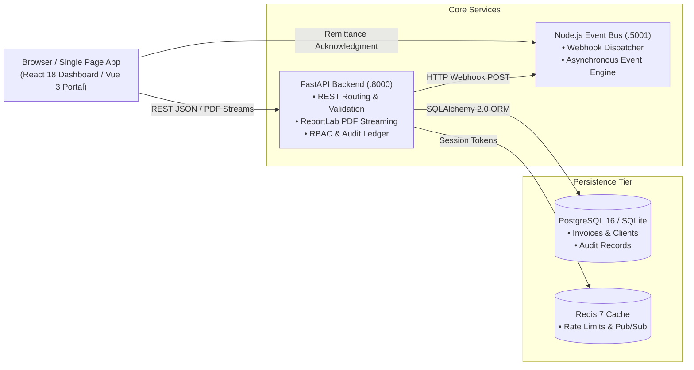

<p align="center">
  
</p>

# PayFlow — Enterprise Invoicing & Receivables Platform

PayFlow is a multi-tenant invoicing and financial operations platform built with Python (FastAPI), PostgreSQL, and a Node.js background event worker. It provides automated tax compliance (Punjab Revenue Authority PRA 16% sales tax on services), itemized PDF invoice streaming via ReportLab, immutable audit trail logging, and multi-entity payment reconciliation.

The platform includes an administrative receivables dashboard built in React 18, a customer remittance portal built in Vue 3, and containerized deployment manifests for Docker Compose.

---

## Architecture

The system follows a polyglot microservice layout separating synchronous financial API operations from asynchronous webhook event dispatching.



### Components

- **Core Backend (`backend/`)**: Python 3.11+ using FastAPI, Pydantic v2, and SQLAlchemy. Handles invoicing math, tax computations, ReportLab PDF generation, and database migrations.
- **Event Worker (`worker-service/`)**: Zero-dependency Node.js HTTP service listening on port `5001`. Ingests webhook events from FastAPI and processes background delivery.
- **Administrative Ledger (`frontend/index.html`)**: React 18 single-page application modeled after modern financial dashboards (Linear/Stripe aesthetic), featuring receivables aging, status filters, itemized invoice creation, and PDF viewer integration.
- **Client Settlement Portal (`client-portal-vue/index.html`)**: Lightweight Vue 3 interface for counterparty invoice verification and RAAST / IBFT bank remittance acknowledgment.

---

## Technical Features

### Automated Tax & Billing Calculations
- Computes line-item totals, applicable sales tax (PRA 16%), and net payable balances with floating-point precision guards.
- Formats monetary amounts in Pakistani Rupee (PKR) and foreign currency denominations.

### Corporate Tax Invoice Generation
- Dynamic PDF generation via ReportLab streaming directly over HTTP with `Content-Disposition: inline` for immediate browser preview.
- Incorporates registered NTN, STRN, line-item breakdowns, Punjab Revenue Authority compliance metadata, and banking remittance instructions (Habib Bank Limited IBAN and RAAST Instant ID).

### Audit Trail & Regulatory Compliance
- Every state mutation (invoice issuance, status transition, payment confirmation) writes an immutable record to the `audit_logs` table.
- Accessible through the administrative compliance tab and REST endpoint `GET /api/v1/audit/`.

### Polyglot Event Bus
- When an invoice is created or marked as paid, FastAPI asynchronously notifies the Node.js event engine over HTTP.
- Ensures decouple operations between the primary database transaction and external notification hooks.

### PayBot — Autonomous AI Financial Controller (Gemini API)
- **Conversational Automation**: Natural language invoicing, aging audits, and status transitions via Google Gemini 2.5 Flash / 1.5 Flash.
- **Native Tool Calling**: Gemini dynamically invokes database-backed functions (`create_invoice`, `update_invoice_status`, `record_payment`, `auto_reconcile_overdue`, `get_financial_summary`).
- **Autonomous Receivables Sweeps**: Identifies past-maturity accounts, updates statuses to `OVERDUE`, recomputes portfolio risk, and logs compliance audits.
- **Resilient Dual-Mode Execution**: Operates via Google Gemini API with seamless fallback to a built-in local autonomous rule engine.

---

## Project Structure

```
payflow-invoicing-platform/
├── assets/
│   ├── logo.svg               # Vector brand banner
│   ├── icon.svg               # Standalone mark
│   └── logo.png               # High-res rendered banner
├── backend/
│   ├── app/
│   │   ├── models/            # SQLAlchemy database entities (Invoice, Client, Payment, User)
│   │   ├── schemas/           # Pydantic v2 validation models
│   │   ├── routers/           # API routes (auth, invoices, clients, analytics, audit)
│   │   ├── services/          # Business logic (PDF generator, auth, event dispatcher)
│   │   ├── config.py          # Environment settings
│   │   ├── database.py        # SQLAlchemy session & engine setup
│   │   └── main.py            # FastAPI application factory & CORS setup
│   ├── seed_data.py           # Database seeder with realistic corporate accounts
│   ├── requirements.txt       # Python dependencies
│   └── Dockerfile
├── frontend/
│   ├── index.html             # React 18 administrative ledger
│   ├── assets/                # App icons and SVG assets
│   └── Dockerfile
├── client-portal-vue/
│   └── index.html             # Vue 3 counterparty remittance interface
├── worker-service/
│   ├── server.js              # Node.js event bus microservice
│   └── Dockerfile
├── docker-compose.yml         # Multi-container orchestration definition
└── README.md
```

---

## Quickstart

### Option 1: Docker Compose (All Services)

Run the full polyglot stack (Postgres 16, Redis 7, Python FastAPI, Node.js Worker, React Nginx):

```bash
git clone https://github.com/hamzaihsan9/payflow-invoicing-platform.git
cd payflow-invoicing-platform

docker compose up -d --build
```

Service endpoints:
- **Operations Dashboard**: http://localhost:3000
- **FastAPI API & Docs**: http://localhost:8000/docs
- **Node Event Worker**: http://localhost:5001/health

---

### Option 2: Local Development Setup

#### 1. Backend Service (FastAPI)

```bash
cd backend

# Create and activate virtual environment
python3 -m venv venv
source venv/bin/activate

# Install dependencies
pip install -r requirements.txt

# Seed corporate test accounts (Systems Ltd, Jazz Telecom, Arbisoft, 10Pearls)
python seed_data.py

# Start development server
uvicorn app.main:app --host 0.0.0.0 --port 8000 --reload
```

#### 2. Node.js Event Worker

```bash
cd worker-service
node server.js
```

#### 3. Administrative Dashboard

Open `frontend/index.html` directly in any web browser, or serve it with Python's static server:

```bash
cd frontend
python3 -m http.server 3000
```

---

## API Reference

The interactive Swagger UI is available at `http://localhost:8000/docs`.

### Primary Endpoints

| Method | Endpoint | Description |
| :--- | :--- | :--- |
| `GET` | `/api/v1/invoices/` | List all invoices with optional client and status filters |
| `POST` | `/api/v1/invoices/` | Create a new invoice and dispatch webhook event |
| `GET` | `/api/v1/invoices/{id}` | Retrieve itemized invoice details |
| `GET` | `/api/v1/invoices/{id}/pdf` | Stream ReportLab corporate tax invoice PDF |
| `PATCH` | `/api/v1/invoices/{id}/status` | Update invoice status (`PAID`, `OVERDUE`, `ISSUED`) |
| `POST` | `/api/v1/invoices/{id}/payments` | Record payment transaction and recompute ledger |
| `GET` | `/api/v1/clients/` | List registered corporate clients and tax identifiers |
| `GET` | `/api/v1/analytics/summary` | Financial KPI aggregates (total billed, settled, outstanding) |
| `GET` | `/api/v1/audit/` | Retrieve chronological compliance audit trail |
| `POST` | `/api/v1/paybot/chat` | Conversational financial controller powered by Gemini AI |
| `GET` | `/api/v1/paybot/status` | PayBot operational health and registered tool schemas |
| `POST` | `/api/v1/paybot/reconcile` | 1-Click autonomous receivables sweep and risk analysis |

### Example Request

Fetch an itemized PDF invoice directly:

```bash
curl -I http://localhost:8000/api/v1/invoices/1/pdf
```

Response:
```http
HTTP/1.1 200 OK
content-type: application/pdf
content-disposition: inline; filename="INV-2026-0001.pdf"
content-length: 3558
```

---

## Authentication & RBAC

The API uses OAuth2 Bearer tokens with JWT signatures. For local exploration and dashboard testing, unauthenticated requests automatically resolve to the pre-seeded administrator profile (`hamza@payflow.pk`).

| Role | Permitted Actions |
| :--- | :--- |
| `ADMIN` | Full administrative privileges, audit log inspection, user management |
| `FINANCE_MANAGER` | Create and issue invoices, update payment statuses, manage client profiles |
| `AUDITOR` | Read-only inspection of invoices, analytics summaries, and audit trail |
| `CLIENT` | Counterparty self-service inspection and payment confirmation |

---

## Testing

Run the automated test suite with pytest:

```bash
cd backend
pytest tests/ -v
```

---

## Author

**Hamza Ihsan**  
Full-Stack & Systems Engineer — Lahore, Pakistan  
- GitHub: [@hamzaihsan9](https://github.com/hamzaihsan9)  
- LinkedIn: [hamza-ihsan-engineer](https://linkedin.com/in/hamza-ihsan-engineer)
