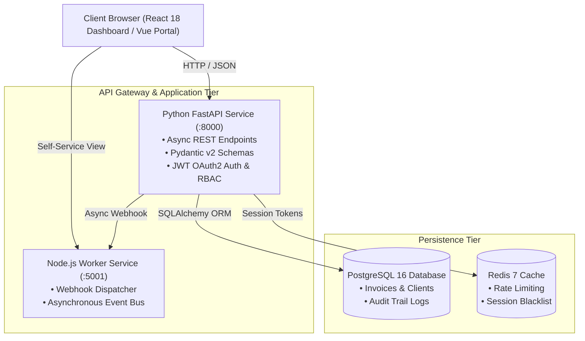

# PayFlow Pro — Enterprise Multi-Tenant Invoicing & Financial Ledger Platform

[](https://fastapi.tiangolo.com/)
[](https://www.python.org/)
[](https://react.dev/)
[](https://nodejs.org/)
[](https://vuejs.org/)
[](https://www.postgresql.org/)
[](https://www.docker.com/)

**PayFlow Pro** is a production-grade B2B multi-tenant financial operations and invoicing platform architected for corporate IT and enterprise compliance standards (FBR/PRA compliant tax workflows, multi-currency receivables, and automated remittance reconciliation via 1Link/RAAST).

---

## 🏗️ System Architecture



---

## 🌟 Key Technical Features

### 1. High-Performance Core (Python & FastAPI)
- **Asynchronous Execution:** Async request handling powered by Starlette and Uvicorn.
- **Enterprise Security:** JWT bearer token authentication with role-based access control (`ADMIN`, `FINANCE_MANAGER`, `AUDITOR`, `CLIENT`).
- **Audit Logging:** Every financial transaction, status transition, and client creation is recorded in an immutable audit ledger table.
- **Branded PDF Generation:** Automated invoice generation using `reportlab`.

### 2. Polyglot Microservices Integration (Node.js)
- Asynchronous webhook processor handling `INVOICE_CREATED` and `PAYMENT_RECEIVED` background workflows.
- Native HTTP event store decoupled from the main database transaction loop.

### 3. Modern Multi-Client Frontend (React 18 & Vue 3)
- **React 18 Operations Dashboard:** Financial KPI cards (Settled vs Outstanding Revenue), interactive invoice builder with live tax calculation, and client directory.
- **Vue 3 Customer Portal:** Lightweight customer self-service interface for reviewing and settling invoices.

### 4. Database & Persistence (PostgreSQL & Redis)
- Normalized relational schema supporting Clients, Invoices, Line Items, Payments, and Audit Logs.
- Zero-downtime containerized volume persistence in Docker Compose.

---

## 🚀 Quick Start Guide

### Option A: Complete Docker Compose Deployment (Recommended)

Boot the entire polyglot stack (PostgreSQL, Redis, Python FastAPI, Node Worker, React Frontend) with one command:

```bash
# Clone the repository
git clone https://github.com/hamzaihsan9/payflow-invoicing-platform.git
cd payflow-invoicing-platform

# Spin up all microservices
docker compose up -d --build
```

Access services:
- **React Enterprise Dashboard:** `http://localhost:3000`
- **FastAPI Interactive Docs (Swagger):** `http://localhost:8000/docs`
- **FastAPI ReDoc:** `http://localhost:8000/redoc`
- **Node.js Event Worker:** `http://localhost:5001/health`

---

### Option B: Local Standalone Development

#### 1. Backend (Python)
```bash
cd backend
python3 -m venv venv
source venv/bin/activate
pip install -r requirements.txt

# Seed initial admin and corporate clients (Systems Ltd, Jazz, Arbisoft, 10Pearls)
python seed_data.py

# Launch FastAPI server
uvicorn app.main:app --reload --port 8000
```

#### 2. Node.js Event Worker
```bash
cd worker-service
node server.js
```

#### 3. Frontend (React)
Open `frontend/index.html` directly in your browser or serve via:
```bash
cd frontend
python3 -m http.server 3000
```

---

## 🔐 Default Seed Credentials

| Role | Email | Password | Access Level |
| :--- | :--- | :--- | :--- |
| **Admin** | `admin@payflow.pk` | `Admin@123456` | Full System Access & Audit Logs |
| **Finance Manager** | `finance@payflow.pk` | `Finance@123456` | Invoices, Clients & Payments |

---

## 🧪 Automated Testing

Run the test suite covering authentication, invoice math validation, and status lifecycles:

```bash
cd backend
pytest tests/ -v
```

---

## 👨‍💻 Author

**Hamza Ihsan**  
Full-Stack & AI Systems Engineer  
- **LinkedIn:** [hamza-ihsan-engineer](https://linkedin.com/in/hamza-ihsan-engineer)  
- **Portfolio:** [Portfolio](file:///home/kali/portfolio/index.html)
